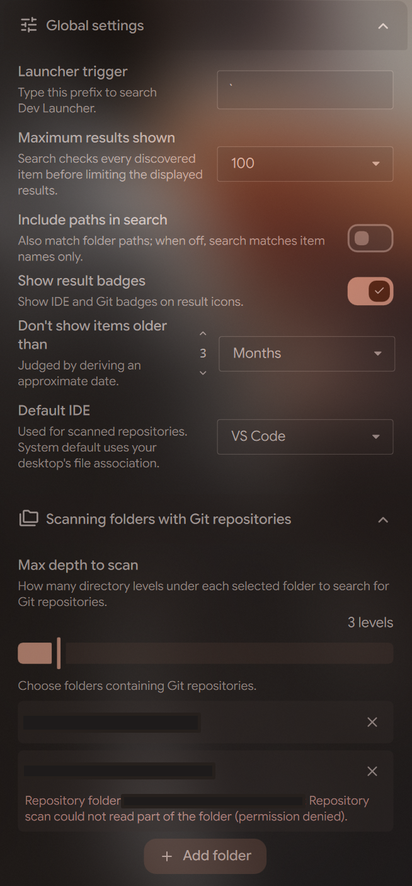

# Dev Launcher Plugin for Dux Shell

A [Dux Shell](https://github.com/duxlabs-dev/dux-shell) launcher plugin. It finds local Git repositories and recently opened files, folders, and workspaces in your IDEs, so you can locate them quickly or open them in the `IDE` you choose (currently `VS Code`, `Zed`, `NeoVim`, `Rider` are supported).

<div align="center">

| Dev Launcher view |
|:---:|
|  |
</div>

## Main Features

- **Repository discovery:** scans the folders you configure for Git repositories and worktrees.
- **Recent `IDE` items:** shows recent files, folders, and workspaces from the IDEs you configure.
- **Several installations of one `IDE`:** add, remove, and rename each installation in settings.
- **Packaging formats support:** support for native IDEs installations, or in `Flatpak`, and `Snap` packaging formats.
- **Actions:** press Tab or open the context menu to open launch options with any configured `IDE`. You can also copy its path or open containing folder.

<div align="center">

| Settings 1 | Settings 2 |
|:---:|:---:|
|  |  |
</div>

## Requirements

- Dux Shell (DMS) 2.0.0 or newer.
- These programs in `$PATH`: `find`, `timeout`, `stat`, `which`, `test`, and `xdg-open`.
- Qt's `LocalStorage`, to read `Sqlite` databases of recent files.

## Items Providers/IDEs

Each provider reads its `IDE`'s own history without changing it. The default locations below apply to a new installation, and you can change them in the installation's settings.

| Provider | Default binary | Default recents locations |
|---|---|---|
| **VS Code compatible** | <ul><li>Native: `$PATH/code`</li><li>Flatpak: `$PATH/flatpak [com.visualstudio.code]`</li><li>Snap: `$PATH/snap [code]`</li></ul> | <ul><li>Native: `~/.config/Code`, `~/.vscode-shared`</li><li>Flatpak: `~/.var/app/com.visualstudio.code/config/Code`, `~/.var/app/com.visualstudio.code/.vscode-shared`</li><li>Snap: `~/.config/Code`, `~/.vscode-shared`</li></ul> |
| **Zed** | <ul><li>Native: `$PATH/zed`</li><li>Flatpak: `$PATH/flatpak [dev.zed.Zed]`</li><li>Snap: `$PATH/snap [zed]`</li></ul> | <ul><li>Native: `~/.local/share/zed`</li><li>Flatpak: `~/.var/app/dev.zed.Zed/data/zed`</li><li>Snap: `~/.local/share/zed`</li></ul> |
| **Rider** | <ul><li>Native: `<Rider installation folder>/bin/rider.sh`</li><li>Snap: `$PATH/snap [rider]`</li></ul> | <ul><li>Native: `~/.config/JetBrains`</li><li>Snap: `~/.config/JetBrains`</li></ul> |
| **NeoVim** | <ul><li>Native: `$PATH/nvim`, after your terminal command</li><li>Flatpak: `$PATH/flatpak [io.neovim.nvim]`</li><li>Snap: `$PATH/snap [nvim]`</li></ul> | <ul><li>Native: `~/.local/state/nvim`</li><li>Flatpak: `~/.var/app/io.neovim.nvim/.local/state/nvim`</li><li>Snap: `~/.local/state/nvim`</li></ul> |
| **Local Git** | <ul><li>Native: `$PATH/find`</li></ul> | <ul><li>Native: folders you add in settings</li></ul> |

## Limitations

- `VS Code` does not record when an item was opened. The plugin estimates each date from the item's place in `VS Code`'s list: the most recent entry takes the history file's time, and each later entry is dated earlier than the one before it, by exponentially growing  period that that is capped at ten days.
- `NeoVim` writes its history file when it exits or when `:wshada` runs, so a session that is still open is not listed yet. The state folder is not detected automatically. If `shadafile` or `$XDG_STATE_HOME` is changed, set the `NeoVim` state folder to match. `NeoVim` records files and folders it has opened, not projects.
- Rider reads `product-info.json` from the installation root, two folders above the launcher. A launcher reached through a symlink, such as one in `~/.local/bin`, has no metadata beside it, so choose the real launcher in the installation's `bin` folder.
- Some remote recent items (like entries from `SSH` sessions) can be opened only with owner IDEs, since server details are defined under that `IDE` only.
- The plugin will check physical existence of the recent items, if the location is unmounted, it will be dropped from the search results.

## Privacy

- The plugin makes no network requests.
- All scans and launches are local.

## Version History

- **v1.0.0:** initial release.

## Install

### Method 1

In Dux Shell:

1. Open `Settings -> Plugins`.
2. Click `Scan for Plugins`.
3. Enable `Dev Launcher`.
4. Open its settings, add repository folders, and add or edit `IDE` installations.

### Method 2

Clone this repository and run the script below. It adds a symlink to the plugin folder:

```bash
chmod +x support/setup-symlink.sh
support/setup-symlink.sh
```

Then scan for plugins and enable `Dev Launcher` in Dux Shell.

## Contributions

Pull requests are welcome. Please follow the [Code Requirements](docs/code_requirements.md).

The plugin has `isDevMode` in `src/Plugin/JS/Helpers/Constants.js`. When it is `true`, logging for debugging is enabled.

## Disclaimers

- The developer has no affiliation with any `IDE` vendor.
- This plugin was developed with AI assistance, under the developer's supervision as a software engineer.
