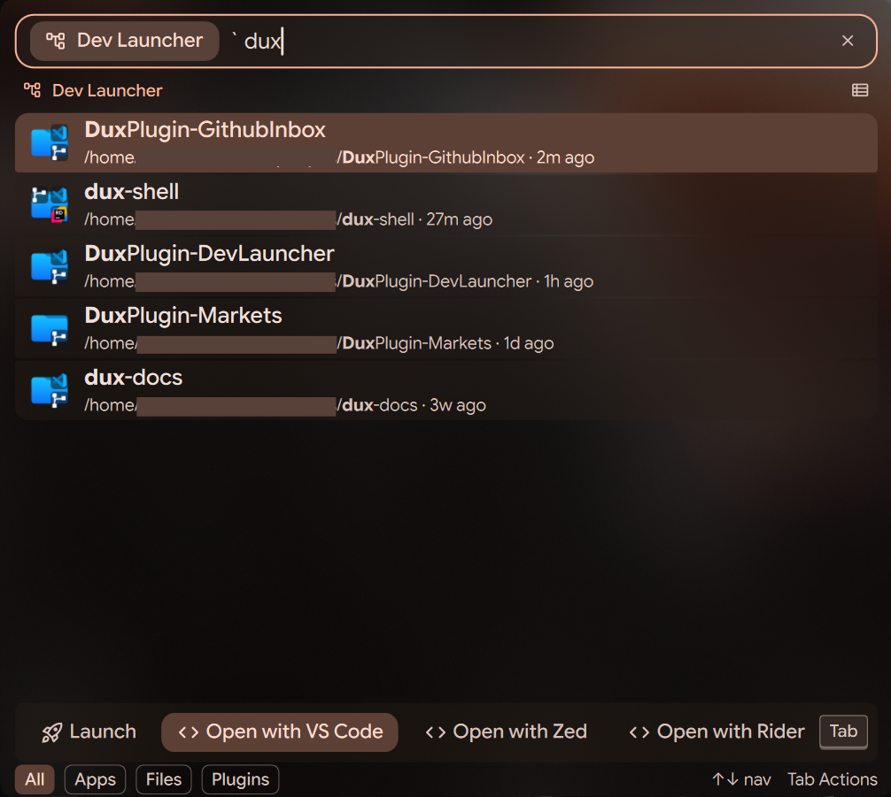
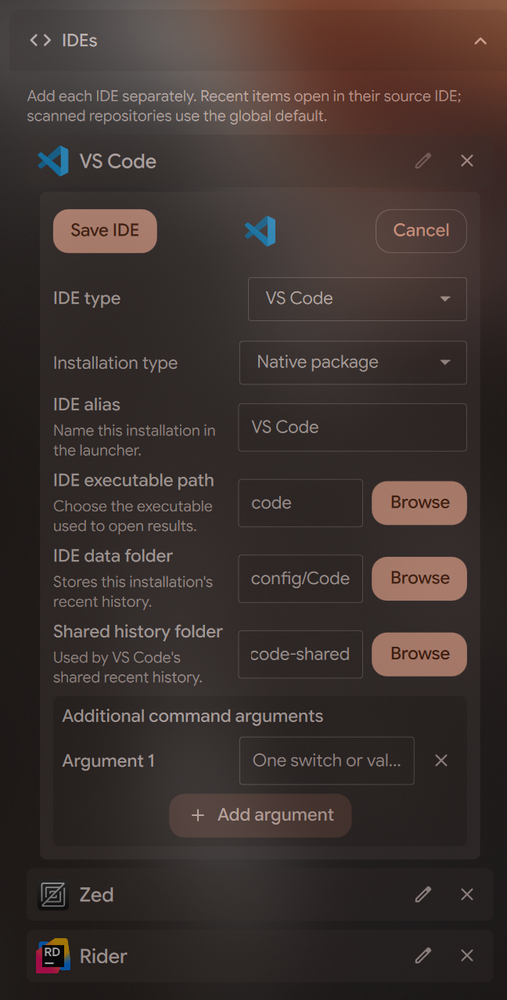

# Dev Launcher Plugin for Dux Shell

A [Dux Shell](https://github.com/duxlabs-dev/dux-shell) launcher plugin that finds local Git repositories and recently opened IDE files, folders, and workspaces, and lets you quickly locate them or open them in the IDE you choose.

<div align="center">

| Dev Launcher view |
|:---:|
|  |

</div>

## Main Features

- **Repository discovery** - scan one or more configured folders for cloned Git repositories and worktrees.
- **Recent IDE items** - show recent files, folders, and workspaces from configured IDE installations.
- **Support for Multiple installations of same IDEs** - add or remove each IDE in settings, give them different aliases.
- **Support for various Packaging formats** select a supported Native, Flatpak, or Snap installation format of your IDE.
- **Result actions** - use Tab or the result context menu to open it with any configured IDE alias, use the system default, open the folder itself or a file's containing folder, copy its path, or view its sources and dates.

<div align="center">

| Settings 1 | Settings 2 |
|:---:|:---:|
|  |  |

</div>

## Requirements

- `Dux Shell (DMS)` ≥ 2.0.0, running on `Qt` ≥ 6.7.
- `find`, `timeout`, `env`, `stat`, `base64`, `cat`, `head`, `which`, `test`, and `xdg-open` available in `$PATH`, plus Qt Quick LocalStorage.
- A configured IDE executable to open results in an IDE. Without one, results open through the desktop's default file association.
- Optional: one or more local folders containing Git repositories.

## Recent Items Providers (IDEs)

Currently supported provider types:

- **VS Code compatible** - reads recent files, folders, and workspaces from the first usable source from following pathes:
        - `<shared folder>/sharedStorage/state.vscdb`
        - `<data folder>/User/globalStorage/state.vscdb`
        - `<data folder>/User/globalStorage/storage.json`.
        The conventional folders are `~/.vscode-shared` and `~/.config/Code`.
- **Zed** - reads workspace and editor history from `db/0-stable/db.sqlite` under the configured data folder. The default folder is `~/.var/app/dev.zed.Zed/data/zed` for Flatpak; the native default is `~/.local/share/zed`.
- **Rider** - reads recent solutions and projects from `Rider*/options/recentSolutions.xml` under the configured JetBrains folder (normally `~/.config/JetBrains`). Native and Snap installations are supported.
- **NeoVim** - reads the files and folders NeoVim has marked in its ShaDa history, `shada/main.shada` under the configured state folder (normally `~/.local/state/nvim`). Native, Flatpak (`io.neovim.nvim`), and Snap (`nvim`) installations are supported. NeoVim runs in a terminal, so each NeoVim installation names a terminal emulator: `ghostty` (the default), `gnome-terminal`, `kitty`, `alacritty`, `foot`, `konsole`, `xterm`, `xfce4-terminal`, `x-terminal-emulator`, or `wezterm`.

## Limitations

Some IDEs (eg. `VS Code`), do not provide information on when the file/folder/workspace where opened last time, hence, the plugin will use item's file/folder modification date(caped by IDE's recent file modification date) instead, as best effort approximation. However this may lead to unexpected order of items in search results.

NeoVim writes its history file when it exits or when `:wshada` runs, so a session that is still open is not listed yet. NeoVim's history location is not detected automatically: if `shadafile` or `$XDG_STATE_HOME` is changed, set the NeoVim state folder to match. NeoVim records files and folders that it has marked, not projects, so a project appears only through the files or folders NeoVim has marked.

## Privacy

- The plugin makes no network requests.
- All scans and launches are local.
- `Dux`'s local file service verifies displayed paths and supplies their icons. Missing paths leave the results; file icons are cached by extension for a bounded time.
- IDE history databases are queried through Qt Quick LocalStorage with SQLite query-only mode. Launchable remote history entries are retained without contacting remote hosts or checking their modification dates; they open only in the reporting IDE installations.
- NeoVim's history file is read as bytes and decoded in JavaScript; NeoVim itself is never started to read it.
- Paths and executables are passed as separate process arguments, without a shell command string.

## Version History

- v1.0.0 :
    - Initial release.
    
## Install

### Method 1

In Dux Shell:

1. Open `Settings -> Plugins`.
2. Click `Scan for Plugins`.
3. Enable `Dev Launcher`.
4. Open its settings, add repository folders, and add or edit IDE installations.

### Method 2

Or clone this repository and run (this adds a symlink to the plugin folder):

```bash
chmod +x support/setup-symlink.sh
support/setup-symlink.sh
```

Then scan for plugins and enable `Dev Launcher` in Dux Shell.

## Disclaimers

- The developer has no affiliation with any IDE vendor.
- This plugin was developed with AI assistance under my supervision as a software engineer.

## Contributions

Feel free to submit a PR, and please follow [Code Requirements](docs/code_requirements.md).

The plugin has `isDevMode` in `src/QML/Tools/Constants.qml`, which enables logging for debugging when true.

## Disclaimers

- The developer has no affiliation with any IDE vendor.
- This plugin was developed with AI under my supervision as a software engineer.
